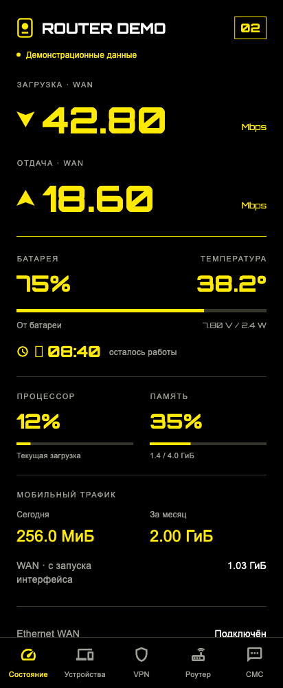
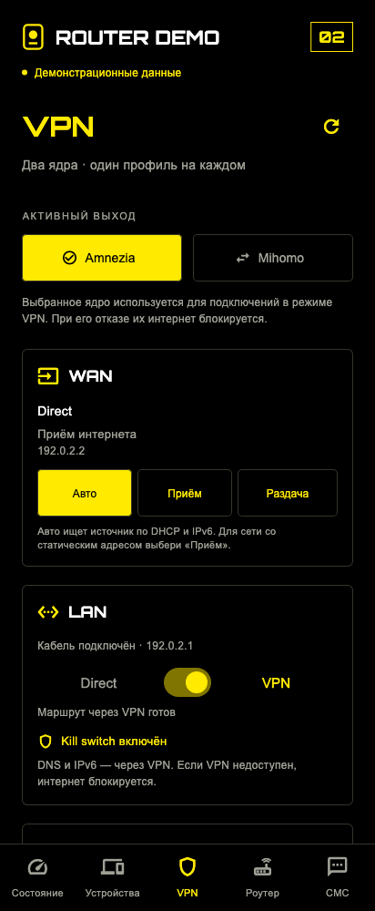
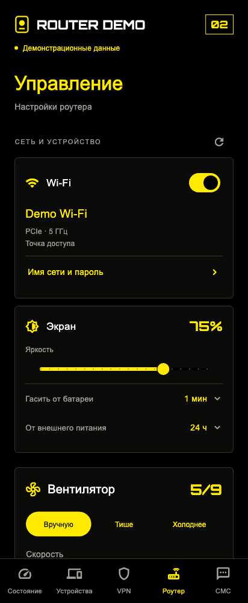
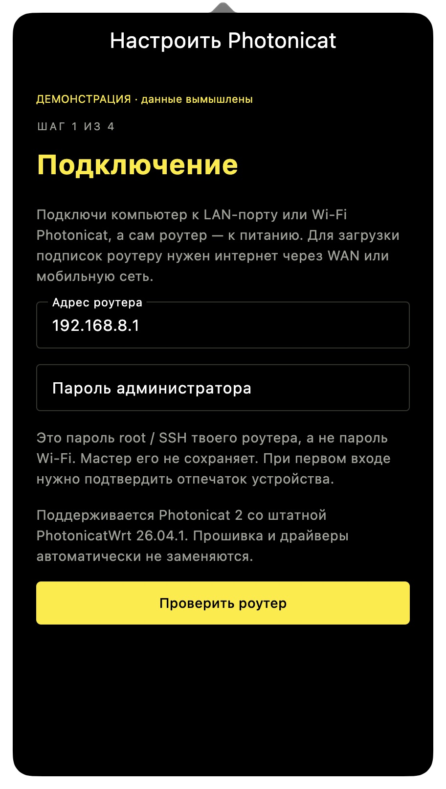
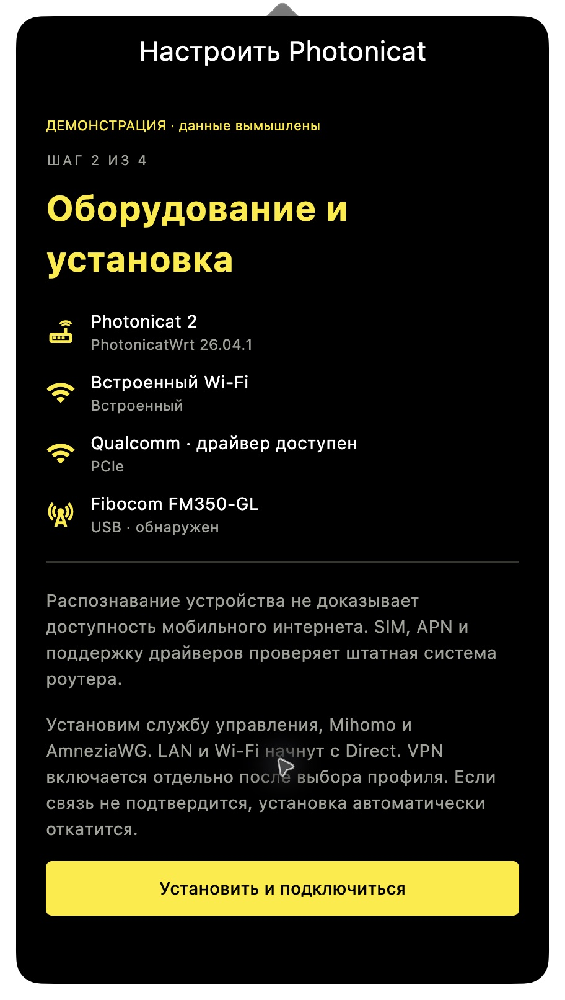
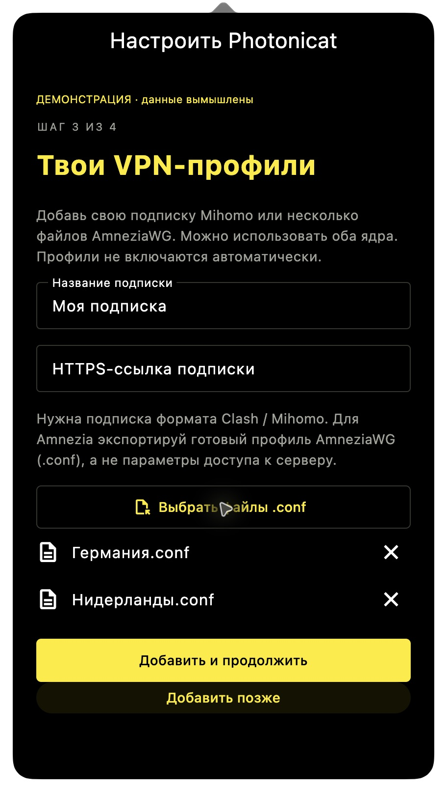
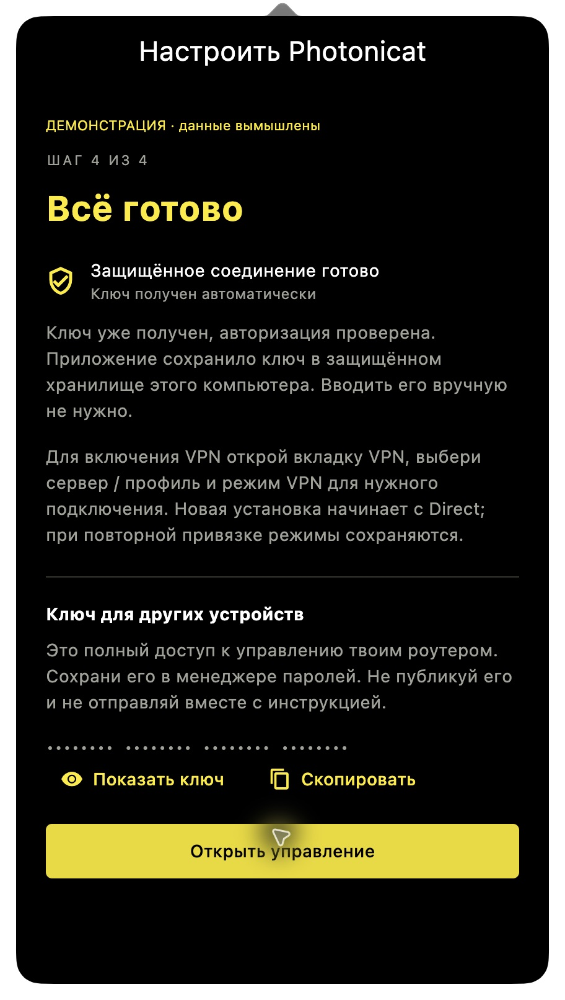

<p align="center"><a href="README.md">English</a> · <a href="README.ru.md">Русский</a></p>
<h1 align="center">Photonicat Companion</h1>
<p align="center">Router telemetry, VPN and device controls on Android, macOS and Windows.</p>
<p align="center">  </p>


Photonicat Companion helps you manage your **Photonicat 2** without opening a console. Check battery and connection speed, control Wi-Fi and VPN, adjust the screen and fan, and read incoming SMS. **Android uses Bluetooth; Mac and Windows use Wi-Fi or Ethernet.**

<p align="center">



</p>
> Sample Android screens with fictional data. The desktop version looks slightly different.

## Download

| Device | Version 0.7.6 beta |
| --- | --- |
| Android 12 or later | [Download APK](https://github.com/svllvsxprod/photonicat-companion/releases/download/v0.7.6-beta.1/Photonicat-0.7.6-Android.apk) |
| Apple Silicon Mac, macOS 12 or later | [Download DMG](https://github.com/svllvsxprod/photonicat-companion/releases/download/v0.7.6-beta.1/Photonicat-0.7.6-beta.1-macOS-AppleSilicon.dmg) |
| Windows x64 | [Download EXE installer](https://github.com/svllvsxprod/photonicat-companion/releases/download/v0.7.6-beta.1/Photonicat-0.7.6-Windows-x64-Setup.exe) |

[All release files](https://github.com/svllvsxprod/photonicat-companion/releases/tag/v0.7.6-beta.1), including portable Windows ZIP, source and checksums. This is a test release: APK uses a test certificate, Windows EXE is unsigned, and Mac uses an Apple development signature without notarization. Your system may show a warning. iPhone is not supported yet.

**New in 0.7.6:** the bundled router service retries when the Bluetooth adapter appears late during startup. Mac and Windows keep automatic reconnection when you switch between Wi-Fi and Ethernet; the pairing key stays saved.

## Install the app

**Mac.** Open the DMG, drag Photonicat into Applications and launch it. Click the yellow cat in the menu bar to open the control panel.

**Windows.** Run the EXE installer. The app appears in the system tray near the clock, sometimes inside the hidden-icons menu. Click the cat to open it. For the portable ZIP, extract the whole archive and run `photonicat.exe`.

**Android.** Download and open the APK on your phone. If prompted, allow installation from that browser or file manager. Install updates over your existing app. If Android reports a signature conflict, save your router key before considering an uninstall.

## Set up your router for the first time

Start on **Mac or Windows**: the desktop app installs the companion service that makes router control possible. You can then connect your phone.

The wizard targets **Photonicat 2 running PhotonicatWrt 26.04.1**. Connect the router to power and your computer to its Wi-Fi or LAN port. WAN can be used for management only when it serves clients, not when it receives internet from another router. The wizard does not flash firmware or install drivers.

Have the router's local address and **root/SSH administrator password** ready. Find the address under “Gateway” or “Router” in your computer's connection settings. Set the administrator password in the router's own interface; it is not the Wi-Fi password. The router needs internet to download a VPN subscription, but you can add VPN later.

The app currently uses Russian labels. The steps below include those labels so you can find the right buttons.

### 1. Connect

Open the cat icon → **Set up router («Настроить роутер»)**. Enter the address and administrator password, then click **Check router («Проверить роутер»)**. The app does not save the password.

On the first connection, you will see the SSH host-key fingerprint: the device's identity. Confirm it only for your own router. If a previously known key changes, establish why first—for example, the device may have been replaced or reflashed.

<p align="center"></p>

### 2. Install the service

The wizard lists the model, firmware, modems and Wi-Fi cards it found. An optional card is not required for basic control. A detected modem does not mean its SIM is active or internet access is working.

Click **Install and connect («Установить и подключиться»)**. The wizard installs the companion service and VPN cores, retrieves the key and checks the connection. Keep power connected and avoid changing network settings during installation. Do not bypass a compatibility error manually.

If the service is already installed, choose **Pair app («Привязать приложение»)**. This uses the existing key and preserves settings. A new installation starts with ordinary internet, **Direct**; you select VPN later.

<p align="center"></p>

### 3. Add your VPN

**Mihomo:** copy an HTTPS Clash/Mihomo subscription URL from your VPN provider's account page, give it a name and paste the link.

**AmneziaWG:** get a client `.conf` file from your provider or export it from Amnezia. Click **Choose .conf files («Выбрать файлы .conf»)**. You can add multiple profiles, up to 24 files of 24 KB each.

Choose **Add and continue («Добавить и продолжить»)** or **Add later («Добавить позже»)**. The wizard does not enable VPN automatically. More subscriptions, files and QR codes can be added later in the VPN tab.

<p align="center"></p>

### 4. Save your key

Your computer has already received the key and stored it securely. Click **Show key («Показать ключ») → Copy («Скопировать»)** and save it in a password manager. You will need it for your phone and other computers.

This key grants control of the router. Do not publish it or share a screenshot with the value revealed. Click **Open controls («Открыть управление»)**.

<p align="center"></p>

*These wizard screenshots use a demo environment with fictional addresses, hardware and filenames.*

## Connect your phone or another computer

**Android:** enable Bluetooth, open Photonicat and paste the saved key into **Your router key («Ключ своего роутера»)**. Tap **Pair Photonicat («Привязать Photonicat»)** and allow Nearby devices access. The key has 64 characters, `0–9` and `a–f`; a Wi-Fi password cannot replace it.

Android controls the router over Bluetooth, so it does not need a Wi-Fi connection for management. To send the phone's internet traffic through the router as well, join its Wi-Fi separately. The management connection pauses when the Android app goes into the background.

**Another Mac or Windows computer:** connect to the router's client network, enter the same key and click **Pair Photonicat («Привязать Photonicat»)**. Leave the optional router address empty for automatic discovery. If discovery fails, enter the address manually.

## Everyday use

| Tab | What it shows or controls |
| --- | --- |
| Status («Состояние») | Battery, temperature, speed, CPU and memory usage. |
| Devices («Устройства») | Router clients. A saved DHCP lease does not always mean a client is online. |
| VPN | Subscriptions, profiles, server selection and connection modes. |
| Router («Роутер») | Wi-Fi, screen, fan and app settings. |
| SMS («СМС») | Incoming SIM messages. Sending and deletion are not supported yet. |

In VPN, select a Mihomo server or AmneziaWG profile and the primary core. Each core has one selected profile. Choose **Direct** for ordinary internet or **VPN** for the desired LAN, Wi-Fi or WAN client connection. WAN controls apply when that port serves clients. VPN mode includes a **kill switch**: if the tunnel stops working, that connection is blocked instead of falling back to direct internet.

Separating Wi-Fi and LAN into different networks can briefly interrupt the connection. The desktop app will look for the router again. Allow a little time after switching Wi-Fi ↔ Ethernet, and keep at least one working path to the router. A command whose reply was lost is not repeated automatically; check whether it took effect first.

**Startup:** Router → Desktop app («Приложение на компьютере») → Start at login («Запускать при входе в систему»). The Mac toggle is available on macOS 13 or later; Windows also offers it during installation. Closing the panel leaves the app in the menu bar/tray. Use **Quit («Завершить»)** in the icon menu to exit completely.

## Troubleshooting

| Problem | What to check |
| --- | --- |
| Phone cannot find the router | Bluetooth, Nearby devices permission, distance and whether the Companion service is installed. |
| Computer receives no data | Connection to the Photonicat client network and access to its local address. |
| Connection does not return after Disconnect | Click Connect («Подключиться»). Manual disconnection deliberately stops discovery. |
| Pairing key is lost | Open the wizard with administrator access and pair with the existing service. |
| Modem is detected but has no internet | SIM, APN and operator registration in the router's own interface. |
| VPN has no internet | Selected server, subscription expiry and profile format. The kill switch deliberately blocks access when the tunnel fails. |

**If Bluetooth disappears after a reboot but desktop control still works:** the service in 0.7.5-beta.1 could start before the Bluetooth adapter and never retry. The 0.7.6 installers include the fix for new router installations. Updating the phone or desktop app alone does not replace an existing router service; pairing again reads its existing key.

For temporary recovery, open Terminal in your router's web interface and run:

```sh
/etc/init.d/photonicat-companion restart
```

This restarts Companion control only, not the modem, Wi-Fi or VPN cores. It is a temporary workaround for the old service; the service bundled with 0.7.6 addresses startup recovery. An authenticated Samsung Bluetooth connection was verified after applying the fix; another reboot of the live router was not tested.

**Legacy Direct IPv6 startup:** source includes bounded waiting for a late network interface. Its startup worker finishes after synchronization; it does not need to keep running. This maintenance fix is separate from app version 0.7.6 and must be applied to an existing router service separately.

When reporting a problem, include the app version, operating system, connection type and error text. Remove keys, passwords, subscription links and VPN configurations.

## Project status

This is an independent app, not an official Photonicat product. No owner's keys, subscriptions or live-router settings are included. GearUP has been removed from the app.

Version 0.7.6 passed 39 Flutter tests, 56 Python tests, code analysis and build checks. The Bluetooth retry tests cover a late adapter, cancellation and cleanup after failed initialization. An authenticated Bluetooth connection was verified on Samsung after fixing the live router. Windows installation, hidden startup and uninstall were checked in the build environment. A factory-fresh router setup, another live router reboot and real Windows networking were not verified. The custom control protocol has not received an independent audit.

<details>
<summary>For developers: builds and tests</summary>

Use Flutter 3.44.2 / Dart 3.12.2. Mac requires Xcode; Windows requires Visual Studio C++ and Inno Setup 6.3+; Android requires an Android SDK and JDK 17.

```sh
cd mobile
flutter pub get
flutter analyze
flutter test
flutter build apk --release
```

From the project root, run `bash tools/build-macos.sh` on Mac or `pwsh -File tools/build-windows.ps1` on Windows. Android currently uses local test signing. Configure your own signing for your distribution; never commit a keystore.

For Python, create an isolated environment, install `requirements-dev.txt`, then run:

```sh
python -m unittest discover -s tests
python -m unittest discover -s tests/setup
python -m unittest discover -s vpn-service -p 'test_*.py'
```

The source includes the router setup payload. `tools/build-public-payload.py` rebuilds it from pinned components and requires Go. `tools/export-public-source.py` exports an allowlist without the private working directory.

</details>

Source is published for inspection; no general reuse license has been selected yet. Third-party components retain their own terms: [rights and dependencies](RIGHTS.md). Matching Mihomo and AmneziaWG source archives are attached to the release.

---

<p align="center">
<a href="https://t.me/tribute/app?startapp=dK9j"></a>
<a href="https://nowpayments.io/donation/svllvsx"></a>
<a href="https://t.me/svllvsxprod"></a>
</p>
