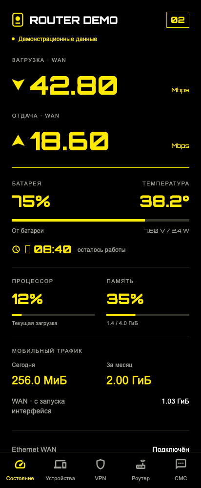
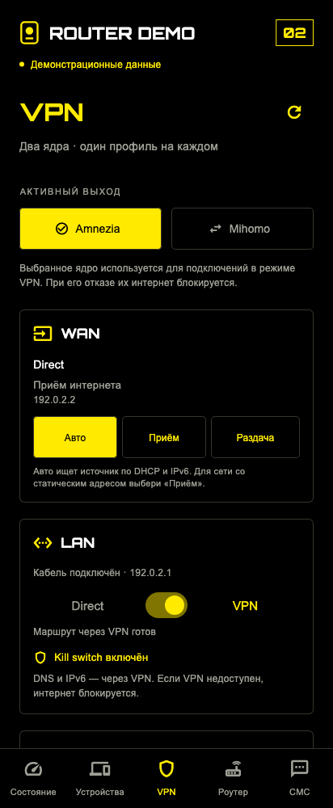
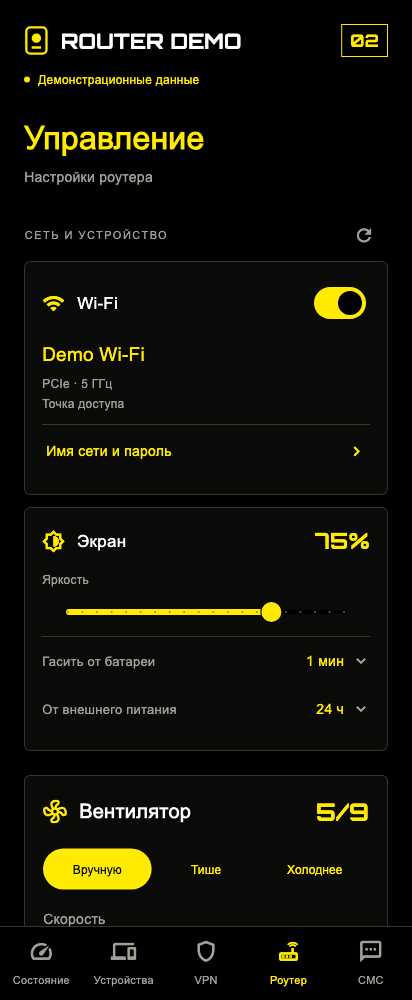

<a href="README.md">English</a> · <a href="README.ru.md">Русский</a>

<h1 align="center">Photonicat Companion</h1>

Мониторинг роутера, управление устройством и VPN с Android, macOS и Windows.

  

> Пример экранов Android. Данные вымышлены; настольная версия выглядит немного иначе.

## Твой роутер — под рукой

Photonicat Companion показывает состояние Photonicat 2 и позволяет управлять Wi-Fi, VPN, экраном и вентилятором. На телефоне связь идёт по Bluetooth. На компьютере — по Wi-Fi или кабелю, а приложение открывается из значка рядом с часами.

### Скачать 0.7.5 beta

| Устройство | Скачать |
| --- | --- |
| Android 12 и новее | [APK](https://github.com/svllvsxprod/photonicat-companion/releases/download/v0.7.5-beta.1/Photonicat-0.7.5-Android.apk) |
| Mac с Apple Silicon, macOS 12 и новее | [DMG](https://github.com/svllvsxprod/photonicat-companion/releases/download/v0.7.5-beta.1/Photonicat-0.7.5-beta.1-macOS-AppleSilicon.dmg) |
| Windows x64 | [Установщик EXE](https://github.com/svllvsxprod/photonicat-companion/releases/download/v0.7.5-beta.1/Photonicat-0.7.5-Windows-x64-Setup.exe) |

[Все файлы и описание выпуска →](https://github.com/svllvsxprod/photonicat-companion/releases/tag/v0.7.5-beta.1)

Это тестовая версия. Система может предупредить о подписи установщика; подробности указаны в описании выпуска. iPhone пока не поддерживается.

### Что умеет

- Показывает заряд, температуру, скорость интернета, загрузку процессора и памяти.
- Управляет Wi-Fi, яркостью экрана и вентилятором.
- Добавляет подписки Mihomo и профили AmneziaWG, переключает обычный интернет и VPN.
- Показывает подключённые устройства и входящие СМС.
- Помогает установить службу управления на роутер через мастер на компьютере.

**Новое в 0.7.5:** на Mac и Windows приложение само восстанавливает связь при переходе с Wi-Fi на кабель и обратно. Повторно вводить ключ не нужно.

### Как начать

1. Установи приложение на компьютер и подключись к Wi-Fi или LAN роутера.
2. Нажми значок кота → **«Настроить роутер»**. Мастер попросит адрес роутера и пароль администратора.
3. Пройди настройку и сохрани выданный ключ. Для телефона установи APK и введи тот же ключ в приложении.

[Настройка с нуля: пошагово и со скриншотами →](docs/public/SETUP_RU.md)

[Установка на телефон, VPN и решение проблем →](docs/public/USAGE_RU.md)

Мастер рассчитан на Photonicat 2 с PhotonicatWrt 26.04.1. Полная установка на роутер из коробки ещё требует проверки. В приложении нет чужих ключей или готовой VPN-подписки — используются только твои.

### О проекте

Независимое приложение, не официальный продукт Photonicat. [Исходники и сборка](docs/public/BUILD.md) · [Права и лицензии](RIGHTS.md). Исходники опубликованы для ознакомления; общая лицензия на их повторное использование пока не выбрана.

---

