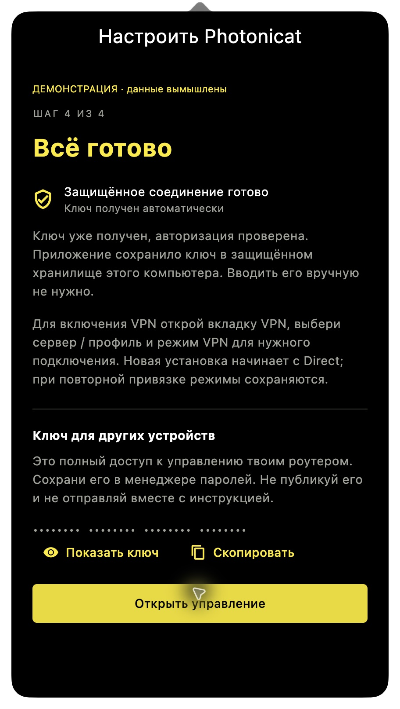

<p align="center"><a href="README.md">English</a> · <a href="README.ru.md">Русский</a></p>
<h1 align="center">Photonicat Companion</h1>
<p align="center">Мониторинг роутера, управление устройством и VPN с Android, macOS и Windows.</p>
<p align="center">  </p>


Photonicat Companion помогает управлять **Photonicat 2** без консоли: смотреть заряд и скорость, настраивать Wi-Fi и VPN, менять яркость экрана и скорость вентилятора, читать СМС. **На Android работает по Bluetooth, на Mac и Windows — по Wi-Fi или кабелю.**

<p align="center">


</p>
> Пример экранов Android. Данные вымышлены; настольная версия выглядит немного иначе.

## Скачать

| Устройство | Версия 0.7.5 beta |
| --- | --- |
| Android 12 и новее | [Скачать APK](https://github.com/svllvsxprod/photonicat-companion/releases/download/v0.7.5-beta.1/Photonicat-0.7.5-Android.apk) |
| Mac с Apple Silicon, macOS 12 и новее | [Скачать DMG](https://github.com/svllvsxprod/photonicat-companion/releases/download/v0.7.5-beta.1/Photonicat-0.7.5-beta.1-macOS-AppleSilicon.dmg) |
| Windows x64 | [Скачать установщик EXE](https://github.com/svllvsxprod/photonicat-companion/releases/download/v0.7.5-beta.1/Photonicat-0.7.5-Windows-x64-Setup.exe) |

[Все файлы выпуска](https://github.com/svllvsxprod/photonicat-companion/releases/tag/v0.7.5-beta.1), включая Windows без установки, исходники и контрольные суммы. Версия тестовая: APK подписан тестовым сертификатом, Windows EXE пока без цифровой подписи, Mac — с подписью разработки Apple без нотариализации. Система может предупредить об этом при запуске. iPhone пока не поддерживается.

**Новое в 0.7.5:** на Mac и Windows приложение само восстанавливает связь при переходе с Wi-Fi на кабель и обратно. Вводить ключ повторно не нужно.

## Установка приложения

**Mac.** Открой DMG, перенеси Photonicat в «Программы» и запусти. Нажми жёлтого кота в строке меню — откроется панель управления.

**Windows.** Запусти EXE и пройди установку. Приложение появится в области уведомлений рядом с часами, иногда под стрелкой скрытых значков. Нажми кота, чтобы открыть панель. Portable ZIP нужно распаковать целиком и запустить `photonicat.exe`.

**Android.** Скачай APK на телефон и открой его. Если Android попросит, разреши установку этому браузеру или файловому менеджеру. Для обновления устанавливай поверх старой версии. При конфликте подписи не удаляй приложение, пока не сохранён ключ роутера.

## Первая настройка роутера

Для роутера из коробки сначала понадобится **Mac или Windows**: компьютер установит службу, через которую приложение управляет устройством. После этого можно подключить телефон.

Мастер рассчитан на **Photonicat 2 с PhotonicatWrt 26.04.1**. Подключи роутер к питанию, а компьютер — к его Wi-Fi или LAN. WAN подходит для управления только в режиме раздачи интернета, а не приёма от другого роутера. Мастер не обновляет прошивку и не устанавливает драйверы.

Подготовь локальный адрес роутера и **пароль администратора root/SSH**. Адрес можно посмотреть в свойствах подключения компьютера, в поле «Шлюз» или «Маршрутизатор». Административный пароль задаётся в штатном интерфейсе роутера; это не пароль Wi-Fi. Для загрузки подписки нужен интернет на роутере, но VPN можно добавить позже.

### 1. Подключись

Открой значок кота → **«Настроить роутер»**. Введи адрес и пароль администратора, нажми **«Проверить роутер»**. Пароль не сохраняется.

При первом подключении появится отпечаток ключа SSH — идентификатор устройства. Подтверждай его только для своего роутера. Если раньше известный ключ изменился, сначала выясни причину, например перепрошивку или замену устройства.

<p align="center"></p>

### 2. Установи службу

Мастер покажет модель, прошивку, найденные модемы и Wi-Fi-платы. Отсутствие дополнительной платы не мешает базовому управлению. Если модем обнаружен, это ещё не означает, что SIM активна и интернет работает.

Нажми **«Установить и подключиться»**. Мастер установит службу управления и VPN-ядра, получит ключ и проверит связь. Во время установки не выключай питание и не меняй сетевые настройки. Если появилась ошибка совместимости, не обходи её вручную.

Если служба уже установлена, выбери **«Привязать приложение»**: используется существующий ключ, а настройки сохраняются. У новой установки обычный интернет **Direct** включён по умолчанию; VPN выбирается позже.

<p align="center"></p>

### 3. Добавь свой VPN

**Mihomo:** скопируй HTTPS-ссылку подписки для Clash/Mihomo из личного кабинета своего VPN-провайдера, придумай название и вставь ссылку.

**AmneziaWG:** возьми клиентский файл `.conf` у провайдера или экспортируй его из Amnezia. Нажми **«Выбрать файлы .conf»**. Можно добавить несколько профилей — до 24 файлов размером до 24 КБ каждый.

Нажми **«Добавить и продолжить»** или **«Добавить позже»**. Мастер не включает VPN автоматически. Дополнительные подписки, файлы и QR-коды можно добавить потом во вкладке VPN.

<p align="center"></p>

### 4. Сохрани ключ

Компьютер уже получил ключ и сохранил его в защищённом хранилище. Нажми **«Показать ключ» → «Скопировать»** и сохрани значение в менеджере паролей: оно понадобится телефону и другим компьютерам.

Этот ключ даёт доступ к управлению роутером. Не публикуй его и не делай скриншот с раскрытым значением. Нажми **«Открыть управление»**.

<p align="center"></p>

*На иллюстрациях показан демонстрационный мастер: адреса, оборудование и имена файлов вымышлены.*

## Подключение телефона и других компьютеров

**На Android:** включи Bluetooth, открой Photonicat и вставь сохранённый ключ в поле **«Ключ своего роутера»**. Нажми **«Привязать Photonicat»** и разреши доступ к устройствам поблизости. Ключ состоит из 64 символов `0–9` и `a–f`; пароль Wi-Fi вместо него не подходит.

Телефон управляет роутером по Bluetooth, поэтому подключать его к Wi-Fi необязательно. Чтобы интернет телефона тоже шёл через роутер, подключись к его Wi-Fi отдельно. При сворачивании Android-приложения связь управления приостанавливается.

**На другом Mac или Windows:** подключись к клиентской сети роутера, вставь тот же ключ и нажми **«Привязать Photonicat»**. Поле адреса можно оставить пустым — приложение попробует найти устройство само. Если не получилось, укажи адрес вручную.

## Повседневное управление

| Раздел | Что внутри |
| --- | --- |
| Состояние | Батарея, температура, скорость, загрузка процессора и памяти. |
| Устройства | Список клиентов роутера. Сохранённая аренда DHCP не всегда означает, что клиент сейчас онлайн. |
| VPN | Подписки, профили, выбор сервера и режима подключения. |
| Роутер | Wi-Fi, экран, вентилятор и настройки приложения. |
| СМС | Входящие сообщения SIM-карты. Отправки и удаления пока нет. |

Во вкладке VPN выбери сервер Mihomo или профиль AmneziaWG и основное ядро. На каждом ядре выбирается один профиль. Для нужного LAN, Wi-Fi или WAN в режиме раздачи выбери **Direct** — обычный интернет — или **VPN**. В режиме VPN действует **kill switch**: если туннель перестал работать, интернет этого подключения блокируется, а не выходит напрямую.

При разделении Wi-Fi и LAN на отдельные сети связь может ненадолго пропасть. На компьютере приложение повторно ищет роутер. После переключения Wi-Fi ↔ Ethernet тоже нужно немного подождать; хотя бы один путь к роутеру должен оставаться рабочим. Команды с потерянным ответом не повторяются автоматически — сначала проверь, применилось ли действие.

**Автозапуск:** «Роутер» → «Приложение на компьютере» → «Запускать при входе в систему». На Mac переключатель доступен с macOS 13, на Windows его также можно выбрать в установщике. Закрытие панели оставляет приложение у часов; для полного выхода выбери **«Завершить»** в меню значка.

## Если что-то не получилось

| Проблема | Что проверить |
| --- | --- |
| Телефон не находит роутер | Bluetooth, разрешение «Устройства поблизости», расстояние и установленную службу Companion. |
| Компьютер не получает данные | Подключение именно к клиентской сети Photonicat и доступность его локального адреса. |
| Нажал «Отключить», связь не возвращается | Нажми «Подключиться»: ручное отключение намеренно останавливает поиск. |
| Потерян ключ | Открой мастер с административным доступом и привяжись к уже установленной службе. |
| Модем виден, но интернета нет | SIM, APN и регистрацию у оператора в штатном интерфейсе роутера. |
| С VPN нет интернета | Выбранный сервер, срок подписки и формат профиля. При упавшем туннеле kill switch блокирует интернет намеренно. |

**Если Bluetooth пропал после перезагрузки, а управление с компьютера работает:** в службе из выпуска 0.7.5-beta.1 обнаружена ошибка — она могла запуститься раньше Bluetooth-адаптера и больше не повторять попытку. Исходники и пакет установки в ветке `main` исправлены: служба ждёт адаптер, сохраняя работу по сети. Ранее опубликованные DMG и EXE ещё содержат старую службу; одно обновление APK её не заменяет.

Для временного восстановления открой «Терминал» в веб-интерфейсе своего роутера и выполни:

```sh
/etc/init.d/photonicat-companion restart
```

Перезапустится только управление Companion. Модем, Wi-Fi и VPN-ядра эта команда не перезапускает. Это временная мера для старой службы; исправление в `main` устраняет причину при запуске. Проверено подключение Samsung по защищённому Bluetooth после установки исправления; повторную перезагрузку действующего роутера отдельно не проверяли.

Сообщая об ошибке, укажи версию приложения, ОС, способ подключения и текст ошибки. Удали ключи, пароли, ссылки подписок и VPN-конфиги.

## Статус проекта

Это независимое приложение, не официальный продукт Photonicat. В комплекте нет личных ключей, подписок или настроек действующего роутера. GearUP из приложения удалён.

Для 0.7.5 прошли 39 Flutter-тестов, анализ кода и проверки сборок. Проверено восстановление реальной связи с роутером после имитации потери адаптера. В Windows проверены установка, запуск и удаление; APK собран, подпись проверена, установка поверх 0.6.1 и работа по Bluetooth на Samsung подтверждены. Полный путь на заводском роутере и физическое переключение Wi-Fi/кабеля в этом выпуске ещё не проверены. Собственный протокол управления пока без независимого аудита.

<details>
<summary>Для разработчиков: сборка и тесты</summary>

Flutter 3.44.2 / Dart 3.12.2. Для Mac нужен Xcode; для Windows — Visual Studio с C++ и Inno Setup 6.3+; для Android — Android SDK и JDK 17.

```sh
cd mobile
flutter pub get
flutter analyze
flutter test
flutter build apk --release
```

Из корня проекта: `bash tools/build-macos.sh` на Mac или `pwsh -File tools/build-windows.ps1` на Windows. Android сейчас использует локальную тестовую подпись. Для своей раздачи настрой собственную подпись; не добавляй keystore в Git.

Для Python создай изолированное окружение, установи `requirements-dev.txt` и запусти:

```sh
python -m unittest discover -s tests
python -m unittest discover -s tests/setup
python -m unittest discover -s vpn-service -p 'test_*.py'
```

В исходники включён пакет служб для установки на роутер. `tools/build-public-payload.py` пересобирает его из закреплённых компонентов; нужен Go. `tools/export-public-source.py` экспортирует разрешённые файлы без рабочей папки с личными данными.

</details>

Исходники опубликованы для ознакомления; общая лицензия на повторное использование пока не выбрана. Сторонние компоненты сохраняют свои лицензии — [права и зависимости](RIGHTS.md). Соответствующие исходники Mihomo и AmneziaWG приложены к релизу.

---

<p align="center">
<a href="https://t.me/tribute/app?startapp=dK9j"></a>
<a href="https://nowpayments.io/donation/svllvsx"></a>
<a href="https://t.me/svllvsxprod"></a>
</p>
