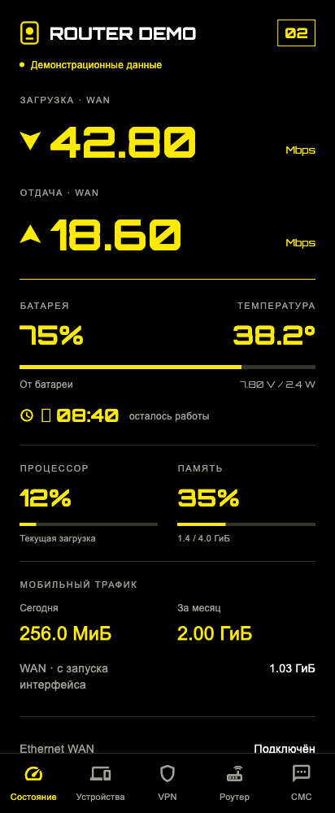
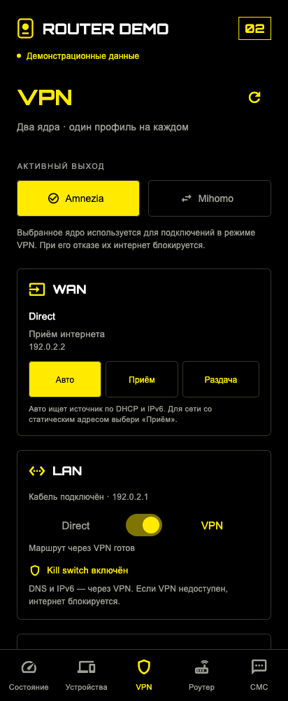
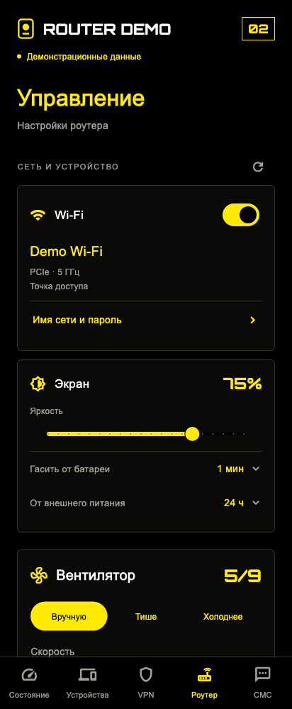

<p align="center"><a href="README.md">English</a> · <a href="README.ru.md">Русский</a></p>
<h1 align="center">Photonicat Companion</h1>
<p align="center">Bluetooth-приложение для мониторинга роутера, управления устройством и VPN.</p>
<p align="center">  </p>

<p align="center">



</p>
> Актуальные виджеты приложения, отрисованные 21.10.2026 в изолированном демо-окружении. Показатели, имена и адреса вымышлены; брендинг заменён. Это не замер работающего устройства.

## Возможности

| Возможность | Реализация |
| --- | --- |
| Мониторинг | Скорость передачи, батарея, температура, CPU, память и счётчики трафика. |
| Пять разделов | Состояние, подключённые устройства, VPN, управление роутером и чтение SMS. |
| Управление роутером | Настройки Wi-Fi, яркость и тайм-аут экрана, ручная скорость вентилятора и готовые режимы. |
| Direct ↔ VPN | Выбор AmneziaWG/Mihomo и управление маршрутом отдельных интерфейсов. |
| Локальная BLE-связь | Flutter-клиент, Python-сервис BlueZ GATT и защита ключом привязки. |

## Исходники

| Каталог | Содержимое |
| --- | --- |
| `mobile/` | Flutter-приложение, проекты Android/iOS и тесты. |
| `router/` | BLE-сервис, мониторинг и управление. |
| `vpn-service/` | VPN-интеграция и документация сервиса. |
| `tests/ · tools/` | Python-тесты и инструменты подготовки. |

## Локальный запуск и проверка

```sh
python3 -m unittest discover -s tests
cd mobile
flutter pub get
flutter analyze
flutter test
flutter run
```

Утилита `tools/provision_phone.py` принимает `PHOTONICAT_SSH_TARGET` и необязательный `ADB`. Она предназначена для осознанной настройки собственного устройства, а не для обычного запуска демо.

## Статус и границы проекта

Основная платформа — Android, минимум Android 12. Проект iOS включён; работа на физическом iPhone здесь не заявляется. Для установки сервиса нужны совместимое окружение Linux/BlueZ и отдельно подготовленные ключи привязки/VPN. Собственный шифрованный протокол не проходил независимый аудит безопасности. Ключи, состояние привязки телефона и снимки реальных данных устройства исключены.

## Права и зависимости

Исходники опубликованы для ознакомления. Общая лицензия на повторное использование собственного кода пока не выбрана. Включённые сторонние компоненты сохраняют свои лицензии: [RIGHTS.md](RIGHTS.md).

---

<p align="center">
<a href="https://t.me/tribute/app?startapp=dK9j"></a>
<a href="https://nowpayments.io/donation/svllvsx"></a>
<a href="https://t.me/svllvsxprod"></a>
</p>
