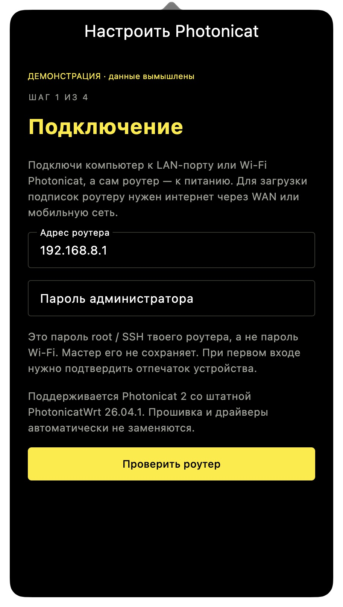
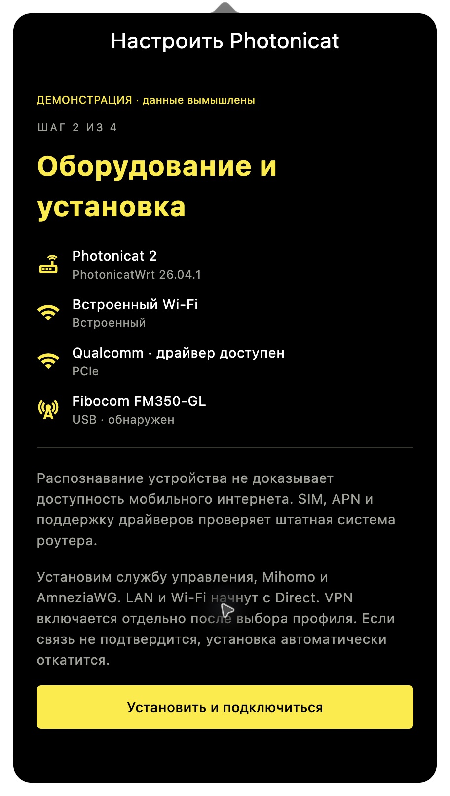
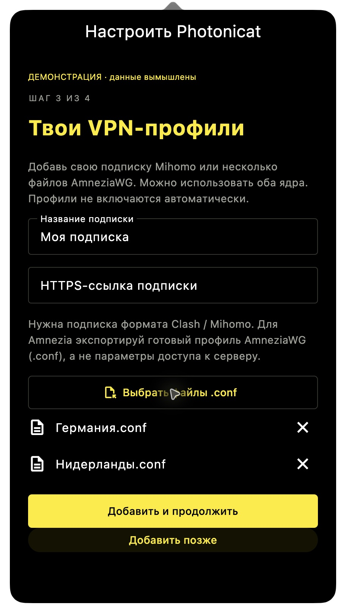
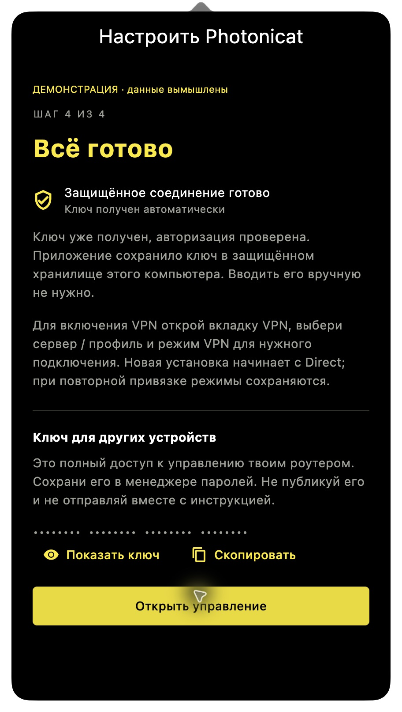

# Настройка Photonicat с компьютера

Инструкция к тестовой версии 0.7.5. Скриншоты мастера сняты в настоящем приложении
в демонстрационном режиме: адрес, оборудование и имена файлов на них вымышлены.
Личных ключей и подписок в иллюстрациях нет.

[Все установщики и APK](https://github.com/svllvsxprod/photonicat-companion/releases/tag/v0.7.5-beta.1) · [Android и повседневное управление](USAGE_RU.md)

## Перед началом

Понадобятся Photonicat 2 со штатной PhotonicatWrt **26.04.1**, питание роутера,
компьютер и пароль администратора роутера. Мастер не перепрошивает устройство,
не устанавливает неизвестные драйверы и не настраивает оператора вместо штатной
системы. Другая прошивка, неоднозначное назначение портов или конфликтующие
сетевые службы могут остановить установку до изменений.

Версию прошивки смотрите в веб-интерфейсе роутера. Официальные прошивки и
инструкции производителя находятся на [странице загрузок Photonicat](https://photonicat.com/downloads?locale=en).
Не обновляйте прошивку без резервной копии своих настроек.

1. Подключите роутер к зарядке.
2. Подключите компьютер к Wi-Fi Photonicat или к его LAN-порту.
3. Для загрузки VPN-подписки обеспечьте роутеру интернет через WAN или SIM.
   Сам пакет служб уже находится в приложении. Без интернета подписку можно добавить позже.
4. Узнайте адрес роутера: это адрес его веб-интерфейса, обычно также указанный
   как шлюз/маршрутизатор в свойствах подключения компьютера.
5. Подготовьте **пароль root / SSH**, заданный владельцем роутера. Пароль Wi-Fi
   и ключ привязки Companion — другие данные. Если административного пароля нет,
   сначала настройте его через штатный интерфейс по инструкции своей прошивки.
   Универсального пароля эта инструкция не предполагает.

## Установка программы на Mac

Откройте DMG и перенесите Photonicat в «Программы». Запустите приложение,
нажмите жёлтого кота в строке меню и выберите **«Настроить роутер»**.
Если приложение уже привязано, этот пункт находится во вкладке «Роутер».

Текущий проверочный DMG подписан сертификатом разработки Apple, без нотариализации.
Он ещё не является готовым установщиком для беспрепятственной раздачи всем владельцам Mac.
Для публичного выпуска потребуется соответствующая подпись и нотариализация.
## Установка программы на Windows

Запустите **Photonicat-0.7.5-Windows-x64-Setup.exe**. Выберите язык установщика,
подтвердите папку установки и нажмите «Установить». Программа устанавливается
для текущего пользователя. При желании отметьте создание ярлыка на рабочем столе.
После запуска нажмите значок кота в области уведомлений рядом с часами;
он может находиться под стрелкой скрытых значков. Затем выберите «Настроить роутер».

Установщик пока не подписан сертификатом Windows. Сборка, установка, запуск
процесса и удаление проверены в отдельной Windows-среде GitHub Actions.
Полноценная проверка кликов по интерфейсу и подключения к настоящему роутеру
на Windows ещё предстоит. Дальнейшие шаги мастера одинаковы для Mac и Windows.

## Автозапуск на компьютере

Откройте вкладку **«Роутер» → «Приложение на компьютере»** и включите
**«Запускать при входе в систему»**. До привязки роутера этот переключатель
также доступен на первом экране приложения. Автозапуск оставляет только значок
в строке меню Mac или трее Windows, без раскрытия окна. Настройка не меняет роутер.

На Mac встроенное управление автозапуском доступно с macOS 13. Сначала перенесите
программу в папку «Программы» и запустите оттуда. Если система требует подтверждения,
приложение покажет кнопку **«Открыть настройки системы»**. Пока разрешение не получено,
статус не выдаётся за работающий автозапуск.

На Windows автозапуск можно выбрать также галочкой в установщике. По умолчанию
галочка снята. Переключатель приложения управляет той же записью; удаление программы
убирает её. Отключение в системных настройках Windows не обходится приложением.

## Шаг 1. Подключение

Введите локальный адрес **своего** роутера и пароль администратора.
Нажмите **«Проверить роутер»**. Пароль не сохраняется приложением.

При первом подключении появится отпечаток SSH-ключа устройства.
Подтверждайте его только при подключении к своему роутеру; при наличии известного
отпечатка сравните значения. Если приложение сообщает об изменении ключа,
сначала выясните причину: например, устройство заменили или перепрошили.

## Шаг 2. Оборудование и служба управления

Проверьте модель, прошивку, список Wi-Fi-плат и модемов.
Отсутствие дополнительной платы или модема само по себе не мешает управлению.
«Обнаружен» означает, что устройство видно системе, а не что SIM активна или интернет уже работает.

Нажмите **«Установить и подключиться»**. Мастер установит Companion, Mihomo и
AmneziaWG, создаст новый уникальный ключ и проверит защищённую связь.
Текущие имя Wi-Fi и пароль сохраняются. Новая установка начинает с **Direct**;
VPN нужно включить после выбора рабочего профиля. Не меняйте параллельно сетевые
настройки роутера и не выключайте питание во время установки.

Если Companion уже установлен, вместо переустановки появится **«Привязать приложение»**.
Мастер получит существующий ключ. Настройки VPN и режимы подключений сохранятся.

Для новой установки предусмотрены резервная копия и автоматический откат,
если проверка связи не подтверждена. Контроль запускается через пять минут
после начала изменений и ждёт завершения установочной операции.
Это не защита от внезапного отключения питания: полный цикл восстановления
на заводском устройстве ещё требует практической проверки.

## Шаг 3. Свои VPN-профили

**Mihomo:** в личном кабинете своего VPN-провайдера скопируйте HTTPS-ссылку
подписки для Clash / Mihomo. Введите понятное название и вставьте ссылку.
Ссылка скрывается при вводе, поскольку содержит личные данные доступа.

**AmneziaWG:** получите у своего провайдера или экспортируйте из Amnezia готовый
клиентский файл `.conf`. Нажмите **«Выбрать файлы .conf»**; можно добавлять файлы
повторно, до 24 профилей, не более 24 КБ на файл. Это именно клиентская конфигурация,
а не SSH-пароль VPN-сервера. Удалить файл из очереди можно крестиком справа.

Нажмите **«Добавить и продолжить»** либо **«Добавить позже»**.
На этом шаге можно добавить одну подписку; дополнительные подписки доступны
во вкладке VPN после настройки. Если импорт не прошёл, проверьте формат и интернет.
Мастер не включает добавленные профили автоматически.

## Шаг 4. Ключ уже получен

К этому моменту приложение проверило ключ и сохранило его в защищённом
хранилище компьютера. Вводить или переносить его вручную для этого компьютера не нужно.

Кнопка **«Показать ключ»** раскрывает значение, **«Скопировать»** переносит его
в буфер обмена. Сохраните ключ в менеджере паролей для подключения других своих
устройств. Через минуту приложение очистит буфер, если там всё ещё этот ключ.
Не делайте публичный скриншот с раскрытым ключом: он даёт полный доступ к управлению.

Нажмите **«Открыть управление»**. Для VPN выберите рабочий сервер Mihomo или
профиль AmneziaWG, основное ядро и режим **VPN** для нужного LAN / Wi-Fi.
В режиме VPN действует kill switch: при недоступном туннеле интернет этого
подключения блокируется. В режиме **Direct** VPN не используется.

На заводской прошивке Wi-Fi может быть объединён с LAN в одну сеть. Чтобы
разделить их режимы, явно выберите Direct или VPN для соответствующей точки
Wi-Fi в приложении: она перейдёт в отдельную сеть. При этом подключение к этой
точке на короткое время прервётся; если компьютер подключён через неё,
версия 0.7.5 автоматически попробует найти роутер по доступным сетевым шлюзам.
Если найти его не удалось, проверьте подключение и адрес роутера в новой сети. До разделения её режим
следует настройке общей сети LAN.

## Если что-то не получилось

- **Не удаётся войти:** проверьте подключение именно к Photonicat, локальный адрес,
  пароль root и доступность SSH в штатной прошивке.
- **Несовместимая конфигурация:** сохраните сообщение мастера; не пытайтесь обойти
  проверку другой моделью устройства. Поддержка сейчас ограничена указанной прошивкой.
- **Модем виден, интернета нет:** сначала проверьте SIM, APN и регистрацию в сети
  через штатный интерфейс. Мастер не прошивает модем.
- **Подписка не добавилась:** убедитесь, что ссылка предназначена для Clash / Mihomo,
  не истекла и доступна через текущий интернет роутера.
- **Ключ не сохранили:** повторно откройте мастер на компьютере, укажите административный
  доступ и выберите привязку к уже установленной службе. Старый ключ не заменяется.

## Что реально проверено

На Mac пройдены четыре экрана демонстрационного мастера и сняты иллюстрации.
На действующем Photonicat выполнены только обнаружение оборудования и проверка
синтаксиса отдельной пустой конфигурации Mihomo. Действующие службы не переустанавливались.
Автотесты проверяют генерацию независимых ключей, конфликты сети, подтверждение
отката, защиту локального транспорта и интерфейс. Полный путь на чистом роутере
пока не подтверждён. На Windows отдельно прошли сборка, автотесты, тихая установка,
проверка работающего процесса и удаление; интерфейс и реальная сеть ещё требуют
проверки. Эту границу нужно сохранять при публикации.
